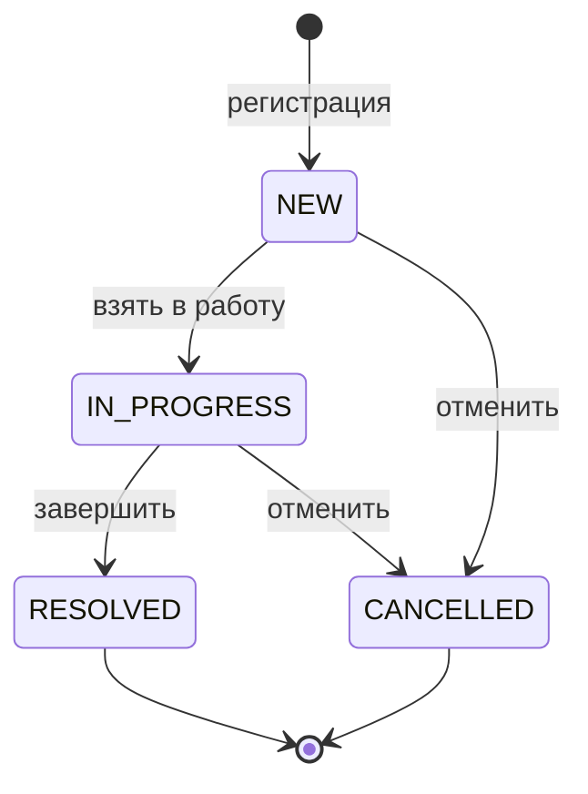
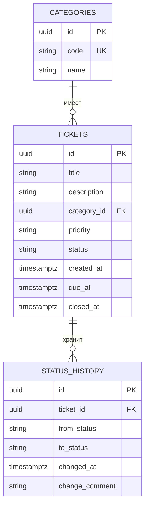

# Спецификация сервиса заявок

## 1. Проблема, пользователи и границы

Сотрудники технической поддержки получают обращения из разных каналов и ведут их вручную. Из-за этого заявки теряются, сроки не отслеживаются, а отчёт за период собирается вручную.

Сервис принимает заявки через REST API, хранит их в PostgreSQL и отдаёт сводку за период. Проверка выполняется через Swagger UI или коллекцию HTTP-запросов.

Пользователи:

- специалист поддержки регистрирует заявку, меняет описание, приоритет, срок и статус;
- руководитель смотрит список, просроченные заявки и сводку за период.

В границы проекта входит один сервис и одна база. Не входят графический интерфейс, аутентификация, микросервисы и Kubernetes. Справочник категорий заполняется миграцией и доступен только для чтения.

## 2. Пользовательские истории и критерии приёмки

### US-1. Регистрация заявки

Специалист создаёт заявку с заголовком, категорией и приоритетом, чтобы обращение не потерялось.

- Заголовок и категория обязательны. Пустой заголовок даёт HTTP 400, заявка не создаётся.
- Приоритет принимает только `LOW`, `MEDIUM`, `HIGH`. Иное значение даёт HTTP 400.
- Неизвестный идентификатор категории даёт HTTP 400 с сообщением «Категория не найдена».
- Начальный статус — `NEW`, время закрытия пустое, время создания берётся из часов приложения.

### US-2. Просмотр заявки

Специалист открывает заявку по идентификатору.

- Существующая заявка возвращается со всеми обязательными полями и признаком просрочки.
- Неизвестный идентификатор даёт HTTP 404. Тело ответа в едином формате ошибки, статус и история не меняются.

### US-3. Редактирование открытой заявки

Специалист меняет описание, приоритет и срок, пока заявка в `NEW` или `IN_PROGRESS`.

- После успешного `PATCH` меняются только эти три поля. Заголовок и статус остаются прежними.
- Пустые описание и срок очищают соответствующие значения.
- Закрытую или отменённую заявку редактировать нельзя: HTTP 409, сохранённые поля не меняются.

### US-4. Смена статуса по правилам

Специалист переводит заявку по допустимой цепочке.

- Разрешены переходы `NEW → IN_PROGRESS → RESOLVED`.
- Отмена разрешена из `NEW` и `IN_PROGRESS`.
- При попытке перевести закрытую заявку в работу API возвращает HTTP 409; статус и история заявки остаются неизменными.
- Прямой переход `NEW → RESOLVED` возвращает HTTP 409, история пуста, статус остаётся `NEW`.
- При переходе в `RESOLVED` или `CANCELLED` заполняется время закрытия.
- Изменение статуса и запись истории выполняются в одной транзакции: если запись истории падает, статус в базе остаётся прежним.

### US-5. История статусов

Специалист смотрит, кто и когда менял статус.

- `GET /api/tickets/{id}/history` возвращает переходы по возрастанию времени.
- В записи есть исходный статус, новый статус, время и необязательный комментарий.
- Для неизвестной заявки возвращается HTTP 404.

### US-6. Поиск и список

Специалист находит заявки по статусу, приоритету, категории, фрагменту заголовка и признаку просрочки.

- Список разделён на страницы. Размер страницы от 1 до 100, сортировка по известным полям.
- Заявка просрочена, если срок уже наступил (`dueAt <= now`), а статус `NEW` или `IN_PROGRESS`.
- В момент равенства срока и текущего времени заявка уже просрочена. За секунду до срока — ещё нет.
- Закрытая и отменённая заявки просроченными не считаются.
- Поиск по заголовку не чувствителен к регистру. Символ `%` в запросе ищется как обычный текст.

### US-7. Справочник категорий

Специалист выбирает категорию из фиксированного справочника.

- `GET /api/categories` возвращает категории, загруженные миграцией.
- Создать или удалить категорию через API нельзя.

### US-8. Сводка за период

Руководитель запрашивает `GET /api/reports/summary` за полуинтервал `[from, to)`.

- В выборку попадают только заявки, созданные в этом интервале. Заявка с `createdAt == to` не учитывается.
- Ответ содержит число созданных заявок, распределение по текущим статусам, распределение по приоритетам, число открытых просроченных и среднее время решения.
- Среднее считается только по `RESOLVED` как разница между временем закрытия и создания. Если завершённых заявок нет, поле равно `null`, а не нулю.
- Если `from >= to` или параметр пропущен, API возвращает HTTP 400.

## 3. Функциональные требования

1. Регистрация заявки с полями: идентификатор, заголовок, описание, категория, приоритет, статус, время создания, срок, время закрытия.
2. Получение заявки по идентификатору.
3. Редактирование описания, приоритета и срока у открытой заявки.
4. Смена статуса по правилам из US-4.
5. Сохранение истории смены статусов, включая необязательный комментарий.
6. Список с фильтрами и пагинацией.
7. Справочник категорий только для чтения.
8. Сводка `GET /api/reports/summary` по правилам US-8.
9. Коды ответов: отсутствие заявки — 404, ошибка валидации — 400, запрещённый переход или правка закрытой заявки — 409.

## 4. Нефункциональные требования

1. Запуск воспроизводится через Docker Compose и Gradle Wrapper. Версии инструментов зафиксированы в README.
2. Данные заявок сохраняются в томе PostgreSQL и переживают перезапуск контейнеров.
3. Все ошибки API имеют один формат: `timestamp`, `status`, `error`, `message`, `path`, `violations`.
4. В репозитории нет паролей и токенов. Образец переменных лежит в `.env.example`.
5. Миграции применяются при старте. Новые миграции только добавляют объекты и остаются совместимы с предыдущей версией приложения.
6. Время в тестах задаётся через `Clock` и не зависит от даты запуска.
7. Логи пишутся в стандартный поток контейнера. Готовность приложения и базы проверяется health check.
8. Есть команды резервного копирования и восстановления в отдельную базу.

## 5. Процесс обработки заявки

Из `RESOLVED` и `CANCELLED` переходов нет. Редактирование описания, приоритета и срока доступно только в `NEW` и `IN_PROGRESS`. Просрочка вычисляется для `NEW` и `IN_PROGRESS`, когда срок уже наступил.

## 6. Модель данных

Миграция `V3` добавляет nullable-столбец `change_comment`. Предыдущая версия приложения его не читает и продолжает работать со схемой после этой миграции.

## 7. Методы API

Подробные примеры запросов и ответов — в [api.md](api.md).

| Метод | Путь | Назначение |
| --- | --- | --- |
| POST | `/api/tickets` | Создать заявку |
| GET | `/api/tickets/{id}` | Получить заявку |
| PATCH | `/api/tickets/{id}` | Изменить описание, приоритет и срок |
| POST | `/api/tickets/{id}/status` | Сменить статус |
| GET | `/api/tickets/{id}/history` | История статусов |
| GET | `/api/tickets` | Список с фильтрами и страницами |
| GET | `/api/categories` | Справочник категорий |
| GET | `/api/reports/summary` | Сводка за период |
| GET | `/actuator/health` | Проверка работоспособности |

## 8. Связь с backlog

Истории US-1…US-8 и инфраструктурные задачи разложены по приоритетам и часам в [backlog.md](backlog.md).
